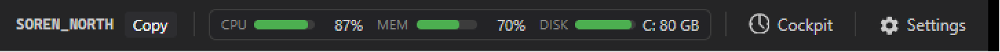
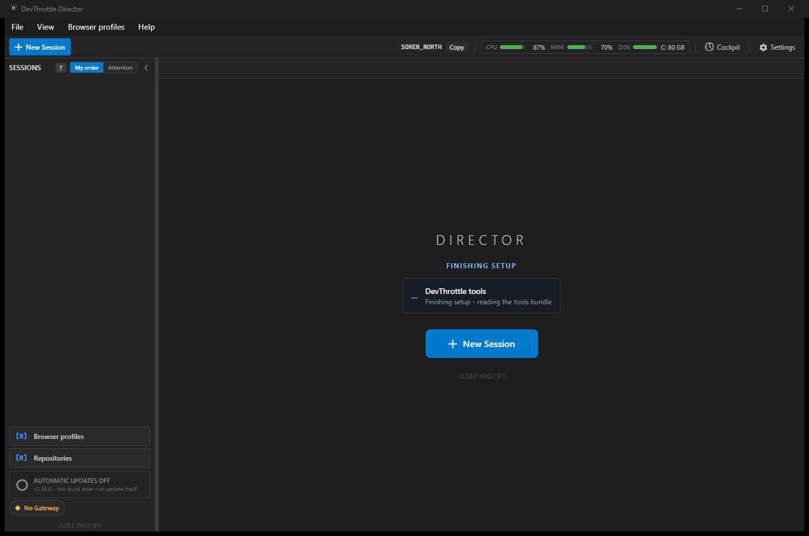
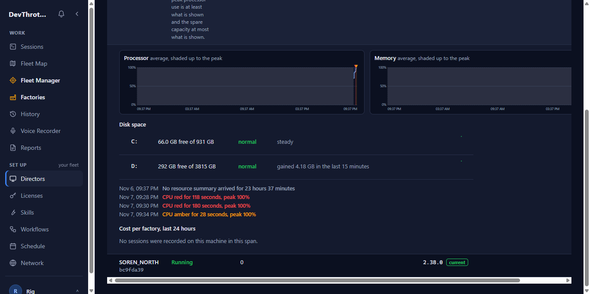
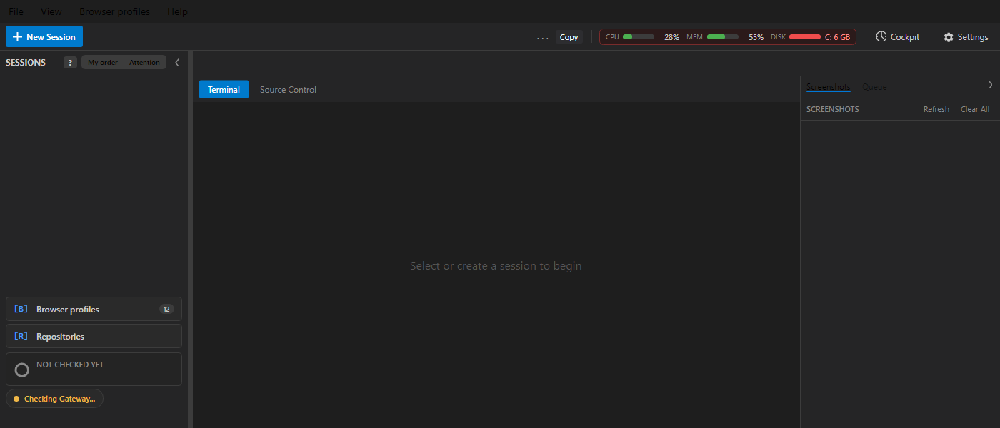
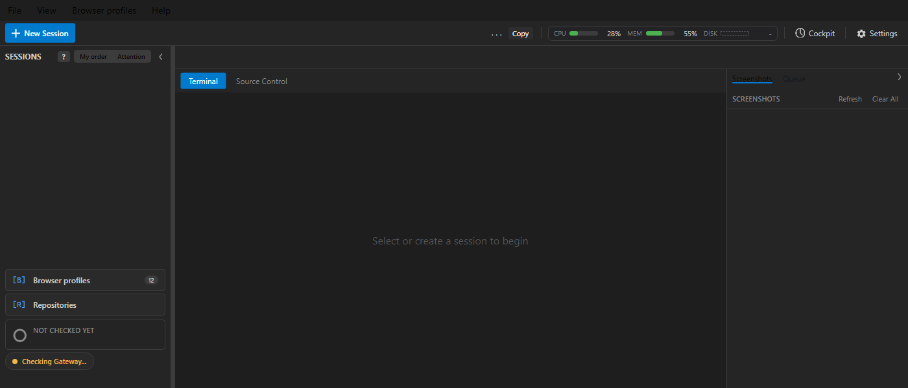
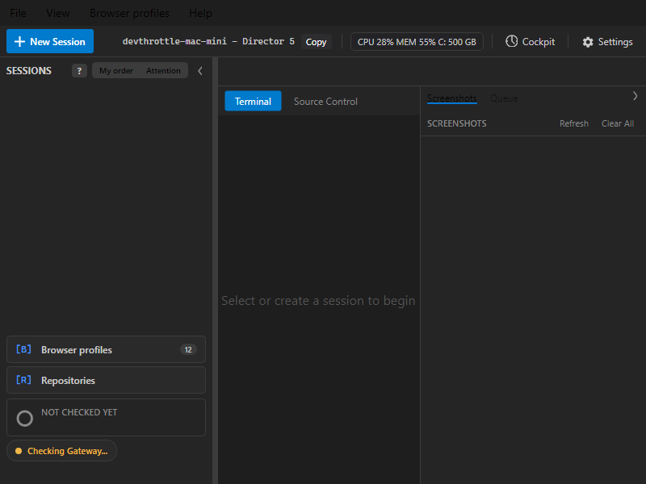

# Disk Space on the Meter - proof

Pull request: https://github.com/thefrederiksen/devthrottle/pull/4763
Head when this was written: `9dc3a45cb` on top of origin/main `1b811bf62`.

## What was built

- **Director toolbar.** A DISK bar always beside CPU and MEM. It fills with how full the tightest fixed drive is and
  says what is left ("C: 80 GB"). Amber under 25 GB free, red under 10 GB free, on any drive, in gigabytes - never a
  share. The tooltip lists every drive and its recent loss. A drive that cannot be read says "cannot read" and why,
  never 0 GB. The compact text reads "CPU 23% MEM 61% C: 6 GB". The fold lives in Core (`ResourceMeterView`,
  `ResourceDetailView`); the toolbar only draws.
- **Reading.** Every fixed drive, every five-second sample, on the sampler thread: Windows (Fixed drive letters),
  Linux (real read-write block devices, see below), macOS (the startup volume).
- **Five-minute upload.** Per drive: total, free at the window end, lowest free, amber and red crossings. New Gateway
  column `drives_json` and table `resource_disk_notice` on both statistics chains (SQLite and PostgreSQL); the
  hand-rolled stamp moves to 9. A window from an older Director, with no drives, is accepted unchanged.
- **Cockpit machine page.** A "Disk space" table: each drive's free space, level, trend and a short history line.
- **Owner inbox.** One Your inbox message when a drive goes under 10 GB (at most once a day per drive), and one when it
  comes back above, through the same `YourInboxStore.Add` path the schedule failure notices use.

## Screenshots

Real Director, test slot 6, its own data folder, launched through the scheduled task and stopped with its named
signal. The DISK figure (C: 80 GB) matched Windows' own figure for C: at that moment (80.56 GB).

Cockpit machine page against a locally run Gateway (the isolated `restart-qa-rig`: its own Gateway on port 7911,
its own Director, its own data folder). The two drives are what that Director uploaded:

The red and unreadable states, rendered headless from the real Avalonia control (this machine has no drive under
10 GB to show for real):

  

## The gate, on the final head 9dc3a45cb

`.\scripts\test-local.ps1 -Parked`, foreground, Debug. RESULT: GREEN, every suite outcome=Completed. The tree was
dirty only by this untracked proof folder.

| Suite | Passed | Skipped |
|---|---|---|
| CcDirector.Core.UnitTests | 3690 | 0 |
| CcDirector.Avalonia.Tests | 1287 | 0 |
| CcDirector.Engine.Tests | 85 | 0 |
| CcDirector.HostedAgent.Tests | 85 | 0 |
| CcDirector.Launcher.Tests | 236 | 0 |
| CcDirector.Terminal.Avalonia.Tests | 111 | 0 |
| CcDirector.Reclaim.Tests | 307 | 0 |
| CcDirector.DeliveryQualification.Tests | 151 | 0 |
| CcDirector.RuleHook.Tests | 70 | 0 |
| cc-director-setup.Tests | 43 | 0 |
| cc-director-setup-engine.Tests | 1029 | 6 |
| cc-director-setup-cli.Tests | 78 | 0 |
| CcDirector.Gateway.Tests (four shards) | 426 + 482 + 439 + 489 | 3 |
| CcDirector.Core.Tests | 4644 | 18 |
| CcDirector.Gateway.UnitTests | 17545 | 0 |

Web tests: Cockpit 138 files, 1506 tests passed; client-core 193 files, 2511 tests passed. On the earlier head the
mobile app (41 files, 214 tests), typecheck and lint were also clean; this last commit touched no web code.

`.\scripts\test-database.ps1` (real PostgreSQL in Docker), on the earlier head: 90 of 91 passed. The one failure is
`PostgresProviderProofTests.Collation_ExplicitC_OnExactlyTheDeclaredNaturalKeys_OnRealPostgres`, about
`factory_boss_starts.SessionId` in the MAIN database. This change touches no main-database file. I did not check
whether it also fails on main.

Free disk space never stopped the gate (C: had 66 GB free at the final run).

## Red without the code, green with it

Each regression test was run with its code mutated away, then the file restored from the commit.

| Mutation | Test(s) that went red |
|---|---|
| The red line includes 10 GB itself | `Level_AmberUnder25GbAndRedUnder10Gb_OnAnyDrive` |
| The amber line includes 25 GB itself | `Level_AmberUnder25GbAndRedUnder10Gb_OnAnyDrive` |
| A set that could not be listed is drawn as a bar | `Meter_DrivesCannotBeListed_TheBarIsUnreadableWithTheReason_NeverZero` |
| The window carries no drives | three `SummaryBuilder_*` tests |
| The store accepts impossible drive figures | five cases of `Store_ImpossibleDriveFigures_TheWindowsFiguresAreRefused` |
| An older Director's window is refused | `Store_AnOlderDirectorsWindow_WithNoDrivesInItsJson_IsAcceptedUnchanged` |
| The migration gives old rows "" instead of "[]" | `Migration_ARowStoredBeforeIt_GetsNoDrives_AndTheNoticeTableAppears` |
| Red again within a day is told again | `Judge_RedAgainWithinADay_IsNotTold_AndNeitherIsItsRecovery` |
| No recovery message | `Judge_BackAboveTheRedLine_AfterARedNotice_IsOneRecovery`, `Notifier_WritesOneRedMessage_...` |
| A zero-size drive is believed (review 1) | `ReadEach_ADriveOfZeroBytes_IsUnreadableWithAReason_NeverAZeroSizedDrive` |
| Only input/output failures are caught per drive (review 7) | `ReadEach_AnyOtherFailure_IsThatDrivesReason_AndTheOthersStillRead` |
| FUSE mounts kept (review 3) | `SelectLinuxMounts_SkipsFuseAndAMountPointThatIsAFile_KeepsFuseblk` |
| A file mount point kept (review 3) | `SelectLinuxMounts_SkipsFuseAndAMountPointThatIsAFile_KeepsFuseblk` |
| A dip leaves the drive red (review 2) | `Judge_ADipInsideOneWindow_IsOneRedNotice_AndNoRecoveryFollows` |
| A dip worded from the end figure (review 2) | `Words_ADipInsideOneWindow_SayItFellAndIsBack_NeverThatTheEndFigureIsUnderTheLine` |
| A held-back spell is never told (review 5) | `Judge_AHeldBackRedSpell_StillRedADayAfterTheLastNotice_IsToldThen_Once` |

## Separate review

A separate review session read head `6902191a7` on a detached worktree and returned two must-fix findings, five
should-fix and four notes. All seven fixes are in `9dc3a45cb`; the same session re-reviewed that commit, confirmed each
fix against the code, and called the change ready to merge once the gate is green (it is, above).

1. **A zero-size drive refused the whole window's processor and memory figures.** Fixed: the reader turns a drive the
   system says is 0 bytes into an unreadable drive with a reason, so the upload never carries one. The store's refusal
   of such a figure stays, as a guard that this producer can no longer trip.
2. **The red notice could say a drive "has 14 GB free, under the 10 GB red line".** Fixed: a drive that dipped under
   10 GB and was back above it by the end of the same five minutes gets one notice saying both ("fell to 8.00 GB ...
   It was back to 14.0 GB free"), and no separate recovery follows.
3. **Linux read FUSE mounts and bind-mounted files.** Fixed: type `fuse` and `fuse.*` are skipped (`fuseblk`, a real
   disk, stays), and a mount point that is not a directory is skipped.
4. **macOS showed a mounted disk image as a permanently red drive.** Fixed by reading the startup volume `/` only.
   **The owner should know: external and second disks on a Mac are not shown.** .NET cannot tell a read-only disk
   image from a real disk under `/Volumes`, and on APFS `/` is the figure that runs out.
5. **A held-back red spell was never told, however long it lasted.** Fixed: a red spell held back by the once-a-day
   rule is told as soon as a day has passed since the last notice, if the drive is still red.
6. **An unreadable drive wrote a log line every five seconds, twice.** Fixed: the reader logs each reason when it
   first appears and again only when it changes; the summary fold's line is gone. The re-review notes that a drive
   which recovers and later fails with the same message is not logged the second time. Accepted as is.
7. **The Windows and macOS probes called the reader unguarded.** Fixed: `ReadThisMachine` never throws, and any
   failure reading one drive becomes that drive's stated reason, not a lost sample.
8. **Note: a drive's amber and red crossings merge into one red run starting at the amber line.** Not changed: it is
   the convention processor and memory crossings already follow, and nothing renders drive crossings yet.
9. **Note: the detail tiles have no consumer, and their trend timeline differs from the tooltip's.** Not changed: the
   detail screen is not built yet (`MainWindow.ResourceMonitor.cs`). When it is, it should feed the tiles the
   sampler's own timeline, as the tooltip does.
10. **Note: validation gaps (no reason required on an unreadable drive, no name or reason length cap), and a ZFS or
    read-only root reads as "no fixed drive was found".** Not changed. The Gateway already caps the drive count at 64.
    A Linux machine whose only disk is ZFS or a read-only root shows DISK as "no fixed drive was found" - honest, but
    empty.
11. **Note: test gaps (the hub's filter of held windows, the GatewayHost wiring, the migration on PostgreSQL in a unit
    test).** The in-window dip and the long silent spell now have tests. The hub filter and the GatewayHost lambda
    are covered only by the live rig run above, which produced the Cockpit page; no inbox notice was produced there
    because no drive was red. The PostgreSQL migration ran only under `test-database.ps1`.

## What is NOT proven

- **Linux and macOS reading never ran on a real Linux or Mac machine.** The Linux mount selection is unit-tested from
  mount-table text; the macOS path is one line. Neither was run.
- **No real inbox notice was seen.** No drive on this machine is under 10 GB. The notice rules and the notifier are
  tested against the real SQLite statistics store with a fake inbox writer; the GatewayHost wiring into the real Your
  inbox was not exercised end to end.
- **The red and unreadable toolbar states are headless renders**, not a live Director.
- **The tooltip was not photographed.** Its lines are unit-tested.
- **The detail screen does not exist yet**, so the per-drive tiles are a fold with tests and no screen.
- **The Cockpit history line is a speck.** The rig had 20 minutes of windows on a 24-hour axis, so each drive's line
  is a few pixels at the right edge. How it looks with a full day was not seen.
- **The Director for the screenshots was built without the native rule hook** (`-NoRuleHook`): this machine has no
  C++ linker. Nothing in this change touches the rule hook.
- **The hourly roll-up does not carry drives**; the Cockpit reads drive history from the five-minute rows (kept 90
  days), so it shows at most what those rows hold.
- **The trend in the toolbar tooltip covers at most the sampler's one hour of history.**
- **The PostgreSQL collation proof failure above** was not checked against main.
