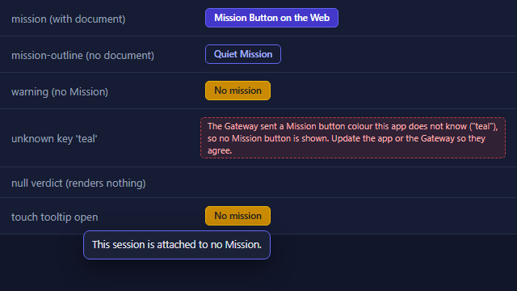

# Mission Button on the Web - Developer proof

Mission: "Mission Button on the Web - the Cockpit and the mobile app show each session's Mission".
Branch `mission-button-web`, cut from origin/main at 1396d7a00. No Gateway change.

## The Gateway already delivers the field

Checked before building, on the branch's base. `StampFleetRolesAndFold` calls `MissionButtonFold.Stamp` on every
row, and all three paths the web clients read pass it the missions:

- the roster read the Cockpit and the phone poll (`GatewayEndpoints.cs`, the `/sessions` handler, `missionsFor:` passed);
- the by-id session read (`GatewayEndpoints.cs`, same call with `missionsFor:`);
- the pushed display-state path (`GatewayHost.cs`, `StampFleetRolesAndFold(..., missionsFor: missionsFor)`).

The wire name is `missionButton` with `verdict`, `label`, `colorKey`, `tooltip`, `documentAddress` (camel case,
the default web serialiser). Nothing to raise.

## What changed

- `packages/client-core/src/api/client.ts` - `missionButton?: MissionButtonDisplay | null` on `SessionDto`, and the
  `MissionButtonDisplay` interface matching the C# contract. Hand-written next to the type, for the same reason
  `modelDisplay` is: the committed `schema.ts` predates the field.
- `packages/client-core/src/sessions/MissionButton.tsx` and `missionButton.css` - the ONE shared component, exported
  as `@devthrottle/client-core/sessions/MissionButton`.
  - Shows `label`, `tooltip` as the `title` attribute, and draws the look `colorKey` names: `mission` indigo #4338CA
    filled (border #6366F1, white text), `mission-outline` the same indigo as an outline (text #A5B4FC, the desktop's
    outline text), `warning` yellow #CA8A04 (border #EAB308) with dark text #1F1F1F.
  - With a `documentAddress` it is a link: `href` is the Gateway's address verbatim, `target="_blank"`,
    `rel="noopener noreferrer"`. Without one it is a button.
  - An unknown colour key draws a visible problem note naming the key, and is reported centrally with
    `reportShownError` (background, so a poll repeating the same broken verdict reports it once). Never a guessed
    colour. An address that is not a path on the Gateway is the same kind of broken contract: it must start with one
    slash, and resolved against the page's own origin it must stay on that origin (review finding 1).
  - A null or absent `missionButton` renders nothing.
  - It never reads `verdict`. The only mapping is colour key to class, which is layout.
  - The tooltip bubble: a long press by a finger (500 milliseconds) shows the tooltip in a small bubble and does not
    open the document; on a button with nothing to open, a click by any pointer shows it. Escape or a tap elsewhere
    closes it.
- Both development servers (`apps/cockpit/vite.config.ts`, `apps/mobile/vite.config.ts`) now proxy `/r/` to the
  Gateway, so the button's new tab works under `npm run dev` too (review finding 5).
- Cockpit `apps/cockpit/src/sessions/SessionDetail.tsx` - mounted in the session header (the tab strip), after the
  model chip and before the session menu, with the selected row's `missionButton`. The brief said "near
  `SessionActionBar`"; the mission document says "the Cockpit session detail header beside its actions". The action
  bar sits at the bottom above the composer and is hidden on the Wingman tab, so the header beside the session menu
  is where both readings meet and where it shows on every tab - the desktop draws it in its tab bar the same way.
  Layout in `apps/cockpit/src/styles.css` (`.session-mission`).
- Mobile `apps/mobile/src/components/SessionAppBar.tsx` - mounted on row 1 of the session app bar, between the spacer
  and the alerts bell, with the live row's `missionButton` (`manage.session`). Row 2 stays the session name's alone.
  Capped at 46 percent of the screen width with an ellipsis, in `apps/mobile/src/styles.css`.
- Roster rows are unchanged.

## Tests

New:

- `packages/client-core/src/sessions/MissionButton.test.tsx` - 15 tests: each colour key, the verdict word never
  picks the look, null and absent render nothing, unknown key shows the note and reports it, a non-Gateway and a
  protocol-relative address are problems, the link target and new tab, no link without an address, tap shows the
  tooltip, long press shows it and blocks the open, a short tap opens normally.
- `apps/cockpit/src/sessions/missionButtonMount.test.tsx` - 3 tests: the selected row's verdict is drawn in the
  header before the session menu (another row's is not), the yellow verdict, nothing without a verdict.
- `apps/mobile/src/components/sessionAppBarMission.test.tsx` - 4 tests: the indigo link in the session app bar, the
  yellow verdict, nothing without a verdict, nothing without a live row.

Results, run on this branch on 7 November 2026 after the review fixes (head given in the handback). The local gate
runs no web tests.

| Package | Type check | Tests | Exit code |
|---|---|---|---|
| `packages/client-core` | `tsc --noEmit` clean | 193 files, 2,495 passed, 0 failed | 0 (three runs, all 0) |
| `apps/cockpit` | `tsc --noEmit` clean | 138 files, 1,504 passed, 0 failed | 0 |
| `apps/mobile` | `tsc --noEmit` clean | 41 files, 214 passed, 0 failed | 0 |

The client-core count is unchanged by the fixes: the backslash case was added as an assertion inside an existing
test. `eslint` on every changed source file: clean. The error display scans in client-core, the Cockpit and the
phone pass with the new problem note (it shows only the reported sentence).

The client-core run CAN exit red without any test failing, on origin/main as well - see review finding 2 below.

## Screenshot

`mission-button-states.png` - the shared component itself, built from the real source and stylesheet into a scratch
page and captured with headless Edge: the three looks, the unknown-key problem note, the null verdict drawing
nothing, and the touch tooltip open.

I could NOT screenshot the two surfaces themselves locally: there is no mock Gateway for the Cockpit or the mobile
app, and running a test Gateway with a Director and missions is out of this seat's scope. The screenshots of both
live surfaces are the mission's quality assurance step after the deploy.

## Review findings

The separate review session (`D:\ReposFred\_briefs\mission-button-web\review.md`) found nothing blocking. Each
finding, answered:

1. **Backslash address left the Gateway.** Fixed. `missionButtonProblem` now resolves the address with
   `new URL(address, window.location.origin)` and requires the result's origin to equal the page's origin, after the
   existing one-slash check. The backslash case `/\evil.example/r/1` is asserted next to the protocol-relative case
   in `MissionButton.test.tsx`, and fails the guard.
2. **The client-core run exits red.** Reproduced, and it is on origin/main too. In a fresh worktree at origin/main
   (45524ef8a), three runs of `npx vitest run` in `packages/client-core`: two exited 1 with the same two unhandled
   `ReferenceError: WebSocket is not defined` from the reconnect timer in `src/terminal/stream.ts` (line 433, from
   `src/terminal/stream.test.ts`), one exited 0. On this branch, after the fixes, three runs all exited 0, which only means the timing
   did not line up for me. Not caused here - neither file is touched. Logged as issue #4738 for a fix or removal of
   the test that leaves the timer armed.
3. **Wrong reason in the comment.** Fixed. The comment on `MissionButtonDisplay` in `client.ts` now says the type is
   hand-written because `schema.ts` has not been regenerated (`npm run gen:api` against a running Gateway) since the
   Gateway gained the field, and that regenerating it makes the interface redundant.
4. **The touch tooltip is unproven on a real phone.** Agreed, and it cannot be proved in jsdom. The pointer
   handlers cancel the press on `pointercancel`; if a phone browser cancels the pointer for its own link menu before
   500 milliseconds, the bubble will not show on the link (the `title` and the click still work, and the buttons
   with nothing to open still show it on a tap). The stylesheet sets `-webkit-touch-callout: none` and the handler
   cancels the context menu to make that less likely, but that is not proof. The Delivery Lead will try the long
   press under touch emulation in the live check; if it fails there, the follow-up is to ignore `pointercancel`
   before the timer fires on a link.
5. **Development proxies did not front `/r`.** Fixed. Both `vite.config.ts` files proxy `/r/`. The key carries the
   trailing slash on purpose: Vite matches proxy keys as prefixes, and a bare `/r` would also send the Cockpit's own
   pages that begin with r (`/reports`, `/repos`, `/requests`) to the Gateway.
6. **A mouse click toggles the bubble too.** Kept, and the comment now says so: on a button with nothing to open, a
   click by any pointer shows the bubble, because that click has nothing else to do; on a mouse surface it repeats
   the hover words.
7. **Literal hex values in a client-core stylesheet.** Answered: neither shell defines an indigo or a warning-yellow
   token, the brief named these exact values, and other client-core stylesheets already carry literals. Recorded
   here so the work that extends the visual style guide to the web knows these three looks exist (indigo #4338CA
   with border #6366F1, outline text #A5B4FC, yellow #CA8A04 with border #EAB308 and text #1F1F1F). Note the
   desktop fills its warning button with #EAB308, the brief's border colour here.
8. **"QA" in the proof file.** Fixed: "quality assurance".
