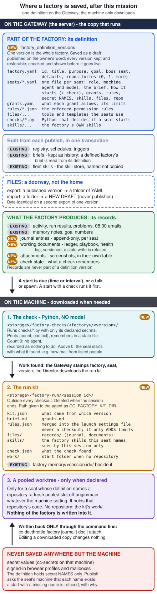
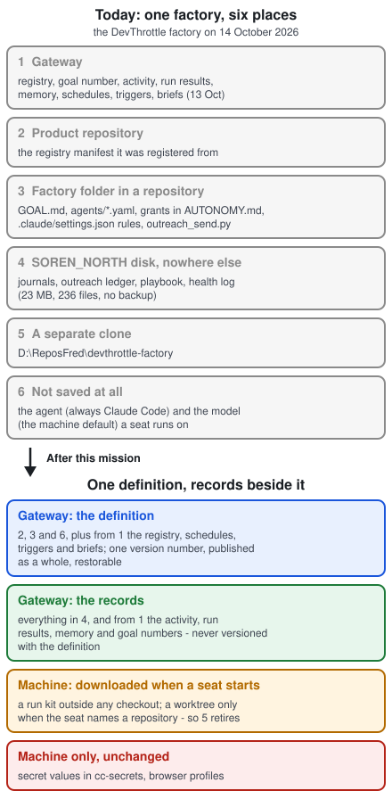

# Mission document - Factory Definition: a factory is one definition on the Gateway

Date: 2026-10-14. Owner: Soren. Architect: session "Factory Definition - Architect - mission document and storage
diagram". Driver after the owner's go: a Delivery Lead, seated top-level and answering to the owner.
Issue: thefrederiksen/devthrottle#3950 (this mission is that issue's Phase 3, "Documents and repositories").
Status: the owner said go on 2026-10-14 (decision F7, section 4). Owner's dev report:
https://gateway.devthrottle.com/r/a4a129d1-e5fb-4fa6-96f1-3cf6647c213b

Inputs, all in `devthrottle_internal/docs/research/warp-factory-engineering-2026-10-14/`:

- The plan the owner read: `factory-definition-plan.html` (https://gateway.devthrottle.com/r/c25479c2-2795-41e8-9ba1-25cffeb6d89d).
  This document replaces it. Where the two differ, this one says why (section 5.9).
- How a factory is saved, Warp against us: `factory-storage.html`. The owner's three yeses came from its questions.
- Warp's factories compared feature by feature: `factories-compared.html`.

It builds on, and must not contradict: Factory Seats phases 1 to 2c (`docs/missions/factory-seats-2026-10-13/MISSION.md`,
merged and deployed 14 Oct), Factory Memory (28 Sep), and the approved Teams, factory agents and policy engine record
(`devthrottle_internal/docs/missions/teams-and-agents-2026-09-19/DESIGN.md`, R3, R7, R9, R13, R20, section 5.2).

## 1. The mission

Every part of a factory that decides how it behaves is one versioned definition on the Gateway, everything the factory
produces is a record on the Gateway, and a machine only downloads what a seat needs when the seat starts.

## 2. The why

The owner, 14 October 2026:

> "We need to get the factories completely fixed the way we were intending them. So, they run standalone on the
> Gateway, but what is required is downloaded to the repo when needed."

Today one factory lives in six places (diagram 2). What that costs, each seen on the DevThrottle factory:

- **A rename is four changes in four places.** On 13 Oct the owner renamed one seat: a registration, a merged pull
  request for a brief, two replacement schedules, a records folder. "Why do we need to merge to change the names of
  things in a factory."
- **Nothing answers "what did this factory look like last Tuesday?"** Only briefs are versioned, one seat at a time.
- **Nothing checks that a factory is whole.** A seat with no brief, or a grant naming a seat that does not exist, is
  found only by reading.
- **A tightened rule binds only from the run after next.** The rules are read from `.claude/settings.json` in the
  folder the run starts in, before the run fast-forwards its checkout. AUTONOMY.md says so.
- **The records exist on one disk.** The outreach ledger ("never a row deleted"), the playbook and every journal are
  only under `%LOCALAPPDATA%\cc-factory\` on SOREN_NORTH: 236 files, 23 MB, measured 14 Oct. No backup, not in git.
- **The seat's agent and model are not saved at all.** Both starters hard-code the agent to Claude Code, and the
  model is whatever the machine defaults to.
- **A factory needs its own clone** (`D:\ReposFred\devthrottle-factory`) even for seats that never touch code.

## 3. The goal

True at the end, each shown in a QA report with the flow AND the failure cases:

1. A factory's definition can be read, saved as a draft, published by a person, listed by version, compared between
   two versions, and restored, from the command line and the Cockpit (desktop; the phone has no factory page today
   and gets none in this mission).
2. A publish is checked as a whole first: an unknown key, a reference that does not resolve, or a secret name the
   seat's machine does not hold is reported with the file and the line, and nothing changes.
3. Before a publish the person sees what will change: seats added, changed and removed, brief text differences,
   schedules created, moved and switched off, rules tightened or loosened.
4. A publish updates the registry, the schedules and the triggers in one transaction, or changes nothing.
5. Renaming a seat is one edit and one publish, and its page, schedules, talks and runs all show the new name.
6. Restoring an older version puts its seats, briefs, schedules and triggers back, as a new newest version.
7. A factory exports to a folder of files and imports from one as a draft. Two exports of one version are
   byte-identical. Import never publishes.
8. A seat started on a machine that has never seen the factory's folder runs correctly from what it downloads.
9. A rule tightened in a publish binds on the very next run, and on every child session the seat starts.
10. Nothing of the factory is written inside a repository checkout. A seat with no repository runs in no repository.
11. The seat's agent and model come from the definition.
12. Journals, working documents and attachments are on the Gateway. Two runs writing the ledger at once: one is
    refused with the current text, and nothing is lost. The one-time upload from SOREN_NORTH counts what it read
    against what it stored, and they match.
13. The DevThrottle factory is recreated from files, published by the owner, and runs one full day of its shifts with
    its repository folder and its separate clone no longer read.
14. A factory with no definition keeps working exactly as it does today, until the owner recreates it.
15. A seat can be started by a check: a Python file held in the definition, run by the Director on the seat's machine
    with no model, on a schedule or on an interval, given only the secret names it declares. When it finds nothing, no
    agent starts and the run is recorded as nothing to do. When it finds work, the agent starts with what the check
    found in its first prompt. Every check run is recorded, and a broken check is a factory problem, never silence.
16. A factory can hold its own skills. A seat that names one has it in its session; no other session has it; nothing
    is written into a checkout or into the user's own skills folder.

## 4. Decisions

The owner's, in his words or by his tap. Settled; never re-asked.

| Id | Decision | Words |
|---|---|---|
| D2 | Documents on the Gateway (13 Oct) | "We should store all documents about the factory on the Gateway, not in the repo. This way the gateway has full control of the factory and run again 0, 1 or more repos." |
| F1 | One versioned definition per factory (14 Oct) | Yes to: "one definition per factory, draft then publish with a 'what changes' summary, every version kept and restorable" |
| F2 | Records on the Gateway (14 Oct) | Yes to: "records go to the Gateway beside memory and activity, so no factory depends on one machine's disk, and a seat can run on any machine" |
| F3 | Export and import as files (14 Oct) | Yes to: "export and import as files; the Gateway copy is the one that runs" |
| F4 | Run standalone, download when needed (14 Oct) | "They run standalone on the Gateway, but what is required is downloaded to the repo when needed." |
| R9 | One YAML file per factory agent (19 Sep) | "What a factory agent is ... I think it's just a YAML file." |
| R20 | Draft until published, versions, roll back (19 Sep) | "It's not live until you publish it ... there needs to be versioning ... you could always roll back." |
| D7 | No conversion tool (13 Oct) | "I can recreate all of them. Almost rather turn them all off and then recreate them one by one." Import from files is how they are recreated. |
| D4 | Boss, no names (8 and 13 Oct) | "She should just be called boss and she shouldn't have a name." A factory has a boss, not a CEO; seats carry role words, never person names. |
| F5 | Factory skills (14 Oct) | "it could come with skills, right, that we could create skills that as part of the factory." |
| F6 | A check in Python decides whether the agent runs (14 Oct) | "we should be able to run python when the factory is scheduled. So the schedule should be able to run just pure Python to check if the whole agent ... should actually run. We have this problem of checking email, and there's no point in having an agent check if there's new email. We might as well run a Python script to check if there's email. If there is email from certain people or some other rules, then we run the full agent." |

| F7 | Go (14 Oct, by tap) | "Yes - merge it and seat the Delivery Lead" |
| F8 | Gateway deploys (14 Oct, by tap) | "Yes, after each merged phase, for this mission only". The grant: the `deploy-hosted-gateway` workflow only, after each merged phase that changes the Gateway, for this mission only. It does not cover a rollback, a tag or any other repository. |
| F9 | One desktop release (14 Oct, by tap) | "Yes, one release by the repository's release procedure, after phase 5". The grant: ONE release, made by the repository's own release procedure and its release gate, after phase 5 merges. A second release is asked for again. |

**F5 is an override, and it names what it replaces.** The approved design (teams-and-agents, section 5.2) says a factory
agent "NAMES the skills and workflows it uses; it never contains them". For this mission, F5 replaces that for skills:
a factory may carry its own skills inside its definition. Fleet skills are still named, never copied. Workflows are
unchanged.

The owner also agreed with every recommendation in `factory-storage.html` (14 Oct).

The Architect's, where the owner has not spoken. Each is a proposal he can replace; each is argued in section 5.

- **A1.** Briefs become part of the definition. The brief store stays as history and as the store for factories with
  no definition.
- **A2.** Two kinds of skill. A factory's OWN skills live in its definition (F5), are versioned and published with it,
  and reach only the seats that name them. Fleet skills from the skill store are named by the seat, never copied in.
- **A9.** A check is the factory's existing trigger check, grown up rather than replaced: the same no-model runner on
  the Director and the same contract (`{"count": N}`), with four additions - the script lives in the definition, it
  may use declared secrets, it can hand what it found to the agent, and it can keep a small state between runs. A
  schedule may carry a check too, not only an interval.
- **A10.** A check decides; it does not do the work. Its job is to say whether the agent runs and with what. A check
  that sends email, writes records or changes anything outside its own state is out of this design.
- **A3.** Tools and templates (`outreach_send.py`, `CEO-BRIEF.md`) are definition files, downloaded into the kit.
- **A4.** Rules reach the agent at launch from the kit, never from a file written into a checkout. An agent that
  cannot take them that way cannot run a seat that has rules: publish refuses it, with the reason.
- **A5.** Attachments get their own table, never inside a journal row, and are not downloaded unless asked for.
- **A6.** Secret names are checked twice: at publish (a finding the person can confirm past) and at start (a refusal).
- **A7.** Records come before the definition is wired to anything (phase 2 here, phase 5 in the plan), because the
  single-disk risk is live today and the records stores depend on nothing else.
- **A8.** No carry-over step for briefs. Export works for a factory with no definition: it writes the folder from what
  the Gateway holds today (registry, briefs, schedules, triggers). Import of that folder is the factory's first
  version. This is D7's path and it replaces the plan's one-time brief copy.

## 5. Design

### 5.1 The picture





Both are generated SVG in this folder; the owner's dev report carries the same two inline.

### 5.2 What a definition holds

Exported, a definition is this folder. On the Gateway the same content is one version row.

```
factory.yaml           id, title, purpose, goal text, boss seat, defaults (machine, agent, model),
                       repositories it may work in (0, 1 or more, by repository name)
seats/<seat>.yaml      ONE file per seat (R9): name, role word, line, machine, agent and model,
                       the brief (prose block), how it starts (each start: when, an optional
                       check, the prompt), grants it uses, rule sets it takes, secret NAMES,
                       skills (the factory's own and fleet skills, by name), files it needs,
                       repository it works in (or none)
grants.yaml            each grant: id, what it allows in plain words, its limits, which seats
rules/<name>.json      enforced permission rules (what .claude/settings.json holds today), named
files/...              tools and templates seats need (outreach_send.py, CEO-BRIEF.md, ...)
checks/<name>.py       checks: Python a Director runs with no model to decide if a seat starts
skills/<name>/SKILL.md the factory's own skills (F5), with any files beside each SKILL.md
```

Field names are the Delivery Lead's first design task, published as a JSON Schema per file type that refuses unknown
keys, as the registry manifest does today. Not in a definition, ever: anything the factory produced (section 5.6),
secret values, and the boss of a seat (the approved design 5.2: the boss is set when it starts; the factory's own boss
seat is named in `factory.yaml`).

### 5.3 The store and the rules around it

- **`factory_definition_versions`**, append-only, keyed by (tenant, factory, version), built exactly like
  `FactoryBriefVersionEntity`: the primary key is the concurrency control across Gateway replicas. A writer sends the
  version it read and is refused with the current one if it is stale. Content is a map of path to text. A row's
  content is never edited; the only later change is the publish mark, set once.
- **Caps** per file and per version, never on history. Starting values for phase 0 to confirm: 256 KB per file,
  4 MB per version.
- **Who writes (R7, Factory Seats P3):** a person, or a session of that factory, saves a draft. Only a person publishes.
  A session's publish is refused with the sentence briefs already use.
- **Each version records** who wrote it (person, or which session), when, and a change note.
- **Checked on save and on publish:** the schema; every reference resolves (each seat's grants, rule sets, skills,
  files and repository exist; the boss seat exists with the role Boss; a schedule names a seat; a machine is
  registered; an agent is one we support); every secret name is asked of the seat's machine (section 5.5).
- **"What changes"**: the Gateway computes the difference against the published version and the Cockpit and command
  line show it verbatim (rule 7: the client renders, the Gateway rules).
- **Applied as one unit:** publish writes the publish mark and updates the registry entry, the schedules and the
  triggers in one database transaction. Any failure leaves the factory exactly as it was, and the error names what
  and where.
- **One source of truth:** once a factory has a published definition, its registry entry, schedules and triggers are
  owned by the definition. The refusal lives on the Gateway routes, so every writer meets it (rule 7): the registry's
  register route; `POST /cron/jobs`, `PUT /cron/jobs/{id}`, `DELETE /cron/jobs/{id}`, and link and unlink (a
  schedule's seat is part of how a seat starts, so it is a definition edit); `POST /triggers`, `PUT /triggers/{id}`,
  `DELETE /triggers/{id}`. Each refuses a write touching a defined factory with "This factory is defined by its
  definition; edit the definition." The command line and the Cockpit show that sentence; they decide nothing.
  Still allowed, because they operate the factory rather than define it, and each is shown: schedule enable and
  disable, trigger pause and resume, run now.
- **Restore** of version N publishes a copy of N as the newest version, through the same transaction.
- **Briefs (A1):** for a defined factory, `factory brief get|set|publish` and the seat page's brief panel read and write
  the seat's brief inside the definition draft. The brief store is untouched for factories with no definition (P5 of
  Factory Seats holds).

### 5.4 Export and import

- `cc-devthrottle factory export <factory> --out <folder> [--version N]` writes the folder. Deterministic: two exports
  of one version are byte-identical. For a factory with no definition it writes the folder from the registry, the
  published briefs, the schedules and the triggers, so the owner's first import of each factory starts from what is
  live (A8).
  A start has no name: a schedule that becomes a start does not carry its old name, and a start's schedule name is
  generated when the definition is published (review of #4007, the Delivery Lead's ruling).
- `cc-devthrottle factory import <folder>` checks the folder exactly as a save would and stores it as a draft,
  creating the factory if it is new. The factory is the one `factory.yaml` names: import never rewrites a file, so a
  copy under a new id is a folder whose `factory.yaml` names that id. It never publishes.
- The Gateway serves the schemas, so an editor or an agent can check a folder without saving it.
- Cockpit: Export downloads a zip; Import uploads one and lands on the draft view.

### 5.5 When a seat starts: downloaded when needed

1. A schedule, trigger, talk or spawn starts a seat. Today only the factory is on a session; `briefVersion` is on the
   run row and the talk. This mission adds **seat** and **definition version** to the start request, the session, the
   session history row and the settle step in `SpawnFactory`, settled from the caller's credential exactly as
   `Factory` is: a session key gives the caller's own seat and version, so a child cannot name another. A child of a
   seat (a review session, a worker) inherits its parent's seat and version, and gets a **rules-only kit**: the
   parent seat's rules and `kit.json`, never its brief, grants or files. The limits travel; the job does not.
2. The Director, before the agent starts, downloads the seat's kit from that version into
   `<storage>/factory-run/<session id>/`, outside every checkout, deleted when the session ends. Same rule and same
   code path as `FactoryMemoryFiles`; the path reaches the agent as `CC_FACTORY_KIT_DIR`, and is added to
   `InheritedSessionEnvironment`'s strip list so a session in no factory never inherits it. A failed download stops
   the start with the reason.
3. The kit holds `kit.json` (what came from which version), `brief.md`, `grants.md`, `rules.json` (the seat's rule
   sets, merged), the files the seat names, and `records/` (recent journal entries and the working documents it
   names), `skills/` (the factory's own skills the seat names), and `check.json` when a check started the seat (what
   the check found). Fleet skills are not in the kit: the Director already installs them from the skill store under
   the user's home and links them per agent, never into a repository. A factory skill is NOT installed there, because
   that folder is shared by every session on the machine; it reaches only this session (section 5.5b).
4. **Rules at launch (A4).** The Director already passes ONE `--settings` file to every Claude Code session, carrying
   its session hooks (`ClaudeHookInstaller`). The kit's `rules.json` is merged into THAT file for the session, so the
   launch line keeps one `--settings`. For Codex, phase 0 finds the equivalent. Rules from a definition only ADD
   limits to whatever the repository has (R13). This closes the "run after next" gap, and because children inherit
   the seat (step 1), the review sessions a seat starts get the rules too.
5. **Secrets (A6).** Before the agent starts, the Director checks every secret name the seat lists exists in
   cc-secrets on that machine. A missing one refuses the start and names the missing entry. Values never leave the
   machine and never appear in any Gateway store. At publish the Gateway asks the seat's machine the same question
   over the Director command channel, with a new verb sent only to a Director that advertises it; an offline machine,
   an older Director or a missing name is a finding the person may confirm past, because the start-time check is the
   one that binds. The Director half ships in phase 5; until then phase 4's publish reports "the machine cannot answer
   yet".
6. **Repository only when declared.** Today an ordinary create takes a pooled slot only when that machine's
   pooled-worktree setting for the repository is on (default off), and otherwise starts in the shared checkout. So a
   seat that declares a repository is started with a new request flag, **`FactoryWorktree`**: the Director takes a
   fresh pooled slot off origin/main (`CcWorktreesPool`) whatever the machine setting says, with the tool's own
   pool-full refusal unchanged, and the kit sits beside the worktree, not in it. The repository is named in the
   definition and resolved to a path through the seat machine's own repository registry; a name not registered on
   that machine is a publish finding and a start refusal naming the repository and the machine.
   A seat with no repository is started with a second flag, **`FactoryHome`**, which the Director resolves to the
   kit's `work/` folder, ignoring `RepoPath`, the way `FleetManagerHome` works today; schedule and trigger
   validation accept an empty repository path only when that flag is set. Both flags are sent only to a Director
   whose hello says it understands them, as `FleetManagerHome` is; an older Director is refused with that reason,
   never started in a checkout. Nothing a seat must keep is kept on the machine: it goes to records. The factory's
   separate clone retires.
7. **Agent and model** come from the seat, else the factory default. The agent goes in `NewSessionRequest.Agent`; the
   model in a new `Model` field the Director composes into each agent's own launch line. `Args` stays the person's
   explicit override, untouched. A scheduled or triggered start always uses the definition; a person starting a talk
   may override agent, model and machine for that one session (the approved design 5.2 lets a start override the
   body and machine), and the override is recorded on the session.
8. **Checks** decide whether steps 1 to 7 happen at all: section 5.5a.

### 5.5a Checks: a script decides whether the agent runs (F6)

The case that asks for it: a seat answers email. Starting a model every ten minutes to look at an empty inbox costs
money and does nothing. A few lines of Python can look, and start the agent only when mail from the right people has
arrived.

**What exists today.** A trigger is already "a check with no model in it that a Director runs on an interval"
(`cc-devthrottle trigger`, `DirectorTriggerRunner`). The Director runs the check command in the trigger's repository
folder with a timeout of half the interval (between thirty seconds and five minutes); a check that exits 0 and prints `{"count": N}`
starts the session when N is above 0, with `{count}` replaced in the prompt; every check is recorded as
`nothing-to-do`, `started`, `paused`, `skipped-running` or `failed`, and written to the activity record. What it cannot
do: the script must live in a repository on the machine; it gets no secrets; it can pass only a number to the agent;
it forgets everything between runs; and a time-of-day schedule cannot have one.

**What this mission adds.**

- **Where the check lives.** In the definition, as `checks/<name>.py`. A seat's start names it:
  ```yaml
  starts:
    - every: 10m                      # or cron: "0 8 * * 1-5", as schedules take today
      check: checks/new_mail.py
      secrets: [outreach-imap-password]
      prompt: "New mail to answer: {count}. What the check found: {context}"
  ```
  A start with an interval MUST have a check (an interval with no check is just a schedule that runs too often). A
  start with a time may have one.
- **Who runs it, who decides.** The Director on the seat's machine RUNS the check and reports what it printed, never
  a model; the Gateway reads it under the contract and DECIDES whether a session starts (rule 7), exactly as today.
  The Director downloads the published `checks/` and `files/` into `<storage>/factory-checks/<factory>/<version>/`
  (its own storage root, so two Directors on one machine never share the folder) and runs the check there, outside
  every checkout, so a check can read a definition file such as `files/mail-rules.yaml` (who counts as "certain
  people").
- **Python.** A check runs with the machine's Python. A check that needs packages declares them in the script's own
  header (inline script metadata, PEP 723) and is run with `uv run --script`. A machine with no Python, or a check
  that declares packages on a machine with no `uv`, is a failed check with that reason and a factory problem; publish
  asks the seat's machine the same question it asks about secret names (section 5.5 step 5). No other interpreter is
  tried.
- **Secrets.** The start lists secret NAMES; the Director runs the check under `cc-secrets run` with those names, so
  the values are in the check's environment and nowhere else, and a check cannot read a name it did not declare.
  The variable each secret arrives in (the Delivery Lead's ruling in phase 5b, replacing a "one rule" that phase 0
  proved false for cc-secrets: with two or more secrets each entry arrives in ITS OWN variable, and `cc-secrets run`
  cannot rename a `--with` entry):
  - Each secret arrives in its own cc-secrets variable (`envName` in `cc-secrets list --json`); an entry with none
    gets the entry name upper-cased, dashes and dots turned to underscores (`outreach-imap-password` is
    `OUTREACH_IMAP_PASSWORD`).
  - With exactly one secret the Director passes `--via env --env-name <that same name>`, so one secret and several
    behave the same, and an entry with no variable is never delivered on standard input. With two or more it passes
    `--with` for each after the first, which supplies every entry in the environment.
  - The Director sets `CC_CHECK_SECRET_VARS` in the check's environment: a JSON object from each declared entry name
    to the variable it arrived in. A check finds its secrets by the entry name it declared, on any machine.
  The question asked at publish and at start is "exists AND is allowed for run" - an entry marked for browser login
  only is refused with the tool's own words, not discovered at the first run.
- **The contract**, today's plus three optional keys. Exit 0 and print one JSON object:
  - `count` (integer, required): 0 means nothing to do.
  - `context` (text, at most 8 KB): what was found, for the agent - the senders and subjects, say. It replaces
    `{context}` in the prompt and is written to `check.json` in the seat's kit. The Director's output cap (8,192
    characters today, `DirectorTriggerRunner.OutputCap`) rises to 16 KB, and the report route's body limit with it, so
    a full `context` always arrives whole.
  - **State is a file, not output.** What the check wants to remember - the last message it saw - is NOT printed. The
    Director writes the stored state into the file named in `CC_CHECK_STATE_FILE` before the run; the check reads it
    and rewrites it; the Director sends the file back with the report, at most 64 KB. The Gateway keeps it in a new
    record, `factory_check_state`, one row per seat and start, every version kept. So a state that grows can never
    break the JSON the contract parses.
  Anything else - a non-zero exit, a timeout, output that is not JSON, a missing `count`, an oversized key or state
  file - is a failed check, recorded with its reason, and a factory problem (below).
- **On a schedule: one runner, never inside the sweep.** The schedule sweep fires due jobs one after another and,
  on the hosted Gateway, every account in turn; a check run inside it would hold every schedule for up to five
  minutes. So when a timed start with a check fires, the Gateway does not wait: it writes a **due check** and returns.
  The Director picks the due check up through the same pull it already uses for triggers
  (`GET /directors/{id}/triggers`), runs it, and reports through the same POST; the Gateway reads the contract and,
  when the count is above 0, starts the session PINNED to the Director that ran the check, as the trigger path
  already does, so `check.json` is on the disk where the kit is built. A Director offline at the due minute runs it
  within one poll of coming back, exactly as a trigger does. A timed check has a fixed timeout of five minutes.
  One runner, one contract, one transport for both kinds of start.
- **One writer of the state.** A due check is CLAIMED by one Director, as a trigger is, and a report from another is
  refused. A published start with a check always has `PreventOverlap` on, and a publish that would turn it off is
  refused. So no two runs of one start ever overlap, and `factory_check_state` has one writer.
- **What the owner sees.** A timed start whose check finds nothing records a new run result, **nothing to do**, which
  is neither pending nor a problem - without it, every quiet morning would read as "did not run". A check that FAILS,
  on either kind of start, writes a problem the problems fold reads, so it reaches the Open problems card and the
  08:00 email, the two places the owner reads; today a failed trigger check only turns the trigger red and writes an
  activity row.
- **Who can make a check run.** A check is code that runs on a person's machine with that person's rights, so it runs
  only from a PUBLISHED version, and only a person publishes (R7). A session may write a check into a draft; it never
  runs until a person has published it, and "what changes" shows the check's full text difference.
- **A check decides, it does not act (A10).** It reads, counts and remembers. Sending, writing records or changing
  anything else is the agent's job, under the factory's rules and grants. A check that does the whole job is a
  different thing - a script with no agent at all - and is not in this mission.

### 5.5b Factory skills (F5)

- A skill lives in the definition as `skills/<name>/SKILL.md`, with any files beside it, versioned and published with
  the factory. A seat lists the skills it gets: its factory's own by name, and fleet skills by name.
- The Director downloads the seat's factory skills into its kit (`skills/`) and makes them visible to THAT session
  only - never into the checkout, never into the user's home skills folder that every session shares. How each agent
  is pointed at a folder of skills outside both is phase 0's proof (c) - the likely route for Claude Code is loading
  the kit folder as a plugin for that one session (`--plugin-dir`); `--add-dir` does not read an added folder's skills.
  For Codex the only documented location is its whole home folder, which would also carry the user's sign-in; 0(c)
  says whether that is acceptable or Codex seats are refused factory skills. If an agent cannot, a seat on that agent that
  names a factory skill is refused at publish, with the reason. No skill is ever copied into a checkout to make it
  work.
- A factory skill and a fleet skill with the same name: the definition check refuses it, so a seat never has to
  guess which one it got.
- Children of the seat do not get its skills (the rules-only kit, section 5.5 step 1).

### 5.6 Records on the Gateway (F2)

Three new stores, beside activity and memory, all tenant-scoped and factory-scoped:

- **Journal entries** (`factory_journal_entries`): append-only, per seat: date, text, the session that wrote it,
  attachment ids. Never edited; corrected by a new entry. Mirrors the activity record.
- **Working documents** (`factory_document_versions`): named documents a seat reads and rewrites - the outreach
  ledger, the playbook, `focus.md`, the health log. Every version kept. A write sends the version it read and a stale
  write is refused with the current text, the rule factory memory uses. Cap per document to be set in phase 0
  (the largest file today is `defects/reads/rows.json`, 642 KB).
- **Attachments** (`factory_attachments`, A5): one row per file, bytes in their own table, never inside a journal row.
  Measured 14 Oct: 143 screenshots, 20 MB, the largest 1.08 MB, in about ten days of one factory. Starting caps for
  phase 0 to confirm: 2 MB per attachment, a per-factory total with a clear refusal when reached. Listed in the kit,
  fetched by command when wanted.

Writes go only through `cc-devthrottle factory journal ...`, `factory doc ...` and `factory attach ...`. Editing the
downloaded copy changes nothing, as with memory today.

**The one-time upload:** one command reads everything under `%LOCALAPPDATA%\cc-factory\` for every factory on the
machine, stores it, and prints read and stored counts that must match. Nothing is deleted locally; deleting the local
copy is the owner's call afterwards (law 18).

### 5.7 The Cockpit

A Definition tab on the factory page REPLACES the Documents tab, whose only content today promises exactly this ("They
will appear here when the definitions move onto the Gateway"): the published version, the draft, the "what changes"
view, Publish, History, Restore, Export and Import. A Records tab beside Memory: journals by seat, working documents
with their versions, attachments. The Gateway composes every word; the Cockpit draws it (rule 7). Desktop only: the
phone has no factory page, and building one is a mission of its own.

### 5.8 Out of this mission

- Scorers, benchmarks and self-improvement (Warp review). The definition gets no place for them yet.
- Webhooks, sending work to a factory, work items, the cross-factory inbox.
- The wider policy engine of epic #2177, factory agents shared between people, and workflows named by a seat.
- A drafting helper model (R20's "large language model should help you create it").
- A factory page on the phone.
- Turning off and recreating the other factories: the owner does it, by import, after phase 7 (D7).
- Deleting `D:\ReposFred\devthrottle-factory` or the local records: the owner's call.

### 5.9 Where this differs from the plan, and why

- **Skills (A2, F5).** The plan put `skills/<name>/SKILL.md` inside the definition; the first draft of this document
  took it out, citing the approved design. The owner then asked for factory skills (F5), so they are back, as an
  override that names what it replaces, and with one change from the plan: they reach only the seats that name them,
  never the machine-wide skills folder.
- **Checks (A9, F6).** The plan had no checks beyond "a trigger's check command may name a definition file". The owner
  asked for Python that decides whether the agent runs; it is built on the existing trigger runner and contract.
- **Records move to phase 2 (A7).** The plan had them fifth. They depend on nothing else, and the ledger is at risk now.
- **No brief carry-over (A8).** Export of an undefined factory gives the owner a folder to import, which is D7's path.
- **One source of truth (5.3).** The plan did not say what happens to a direct schedule edit after publish. Two
  writers of one schedule is the drift this mission removes, so the direct edit is refused.
- **Secrets are checked at start, not only at publish (A6).** A publish check on an offline machine proves nothing;
  the start check always runs where the secret is.
- **Attachments have their own table (A5)**, from the measurement, instead of "phase 0 picks the store".
- **Seat, version, worktree, home folder and model are new fields on the start request.** The plan assumed the
  session already carried a version, that a pooled worktree was there for the asking, and that a seat could start
  with no repository. The review showed none of the three is true today (section 11).
- **An agent that cannot take rules at launch is refused, not worked around (A4).** The plan said "stop and report"
  for phase 0; this says what the product does if the answer is no for one agent: it refuses a rules-bearing seat on
  that agent. No rules are ever written into a checkout.

## 6. Phases

Each phase merges to main on green with its QA report beside the code, read first by a reviewer on a different agent.
A Tech Lead is seated for phases 1, 4 and 5, which carry real back and forth; the others go straight to a Developer.

| Phase | What is built | Runs beside | Tech Lead |
|---|---|---|---|
| 0. Proofs and inventory (about a day) | (a) Claude Code, launched with the Director's REAL line (its one `--settings` file holding the session hooks with a deny rule merged in, and the permission-bypass flag the Director passes by default): the merged deny binds, the hooks still fire, and the start folder's own `.claude/settings.json` deny binds too - both refused. A proof under any other launch line does not count. (b) The same for Codex, or the finding that it cannot. (c) A folder of factory skills OUTSIDE both the checkout and the user's home reaches each agent's session, and only that session - in a worktree and in a non-repository folder; fleet skills still reach both. Record the name a skill gets inside the session (a plugin namespaces its skills), because a brief must name it the way the agent sees it. (d) Today's records measured per factory, setting the caps. (e) Every factory's current parts listed, for phase 7. (f) Every machine a factory seat runs on today listed with its registered repositories, for the resolve rule in 5.5 step 6. (g) The email check written for real against the Outreach seat's mailbox, run by hand under `cc-secrets run`, printing the contract, once with one secret and once with two - so phase 5b starts from a check known to work and the variable-name rule is proven. Proofs are committed scripts and their output under `docs/qa/factory-definition/phase-0/`. If (a) fails, stop and report to the owner: the design depends on it. | - | No |
| 1. The definition store | Table and migrations (SQLite and Postgres), store, routes, `cc-devthrottle factory definition get\|history\|save\|publish\|restore\|diff`, schemas, the whole-definition check, "what changes", person-only publish. No change to how anything runs. | Phase 2 | Yes |
| 2. Records on the Gateway | Journal, working document and attachment stores, routes, commands, the one-time upload. | Phase 1 | No |
| 3. Export and import | Export (including an undefined factory), import as draft, schemas served. | After 1 | No |
| 4. Publish drives the factory | One transaction over registry, schedules, triggers, written through one database context of its own (the three stores each open their own today, so it cannot be composed from their methods); the route refusals of 5.3; restore; brief commands and the seat page through the definition; the publish-time secret question, reporting "cannot answer yet" until phase 5. | After 1 | Yes |
| 5. The run kit | Seat and definition version on request, session, history and `SpawnFactory`; the `FactoryWorktree`, `FactoryHome` and `Model` request fields with their hello capabilities; download at start, `CC_FACTORY_KIT_DIR` and its strip; rules merged into the launch settings file; rules-only kit for children; start-time secret check and the publish-time verb; records in the kit; factory skills in the kit, visible to that session only. Needs a desktop release to reach machines (question 3). | After 2 and 4 | Yes |
| 5b. Checks | Checks from the definition on the Director (download to `factory-checks`, Python and `uv`, secrets through `cc-secrets run` with the one variable-name rule, `context`, the state file, `factory_check_state`, the output cap raised); due checks for timed starts through the existing trigger pull and report, claimed, the start pinned; `PreventOverlap` forced on; the **nothing to do** run result; failed checks into the problems fold and the 08:00 email; the interpreter and "allowed for run" questions at publish; the email check as the first real one. | Beside 5, after 4 | Yes |
| 6. The Cockpit | Definition tab replacing Documents, and Records tab. Desktop only. | After 4; the Records tab after 2 | No |
| 7. The first real factory | The DevThrottle factory written as a folder from today's files, imported, shown to the owner as a draft; he publishes. Its schedules switch to the definition; one full day of shifts runs from the Gateway alone with its folder and clone not read (proven by renaming the folder away for the day). The owner then recreates the others by import. | After 5 and 6 | No |

## 7. The check

Run by the seat that receives the work, from a worktree of the branch rebased onto origin/main:

```
.\scripts\test-local.ps1
dotnet test src/CcDirector.Gateway.UnitTests --filter "FullyQualifiedName~Factory|FullyQualifiedName~Cron|FullyQualifiedName~Trigger"
dotnet test src/CcDirector.Gateway.Tests --filter "FullyQualifiedName~Factory"
dotnet test src/CcDirector.Core.Tests --filter "FullyQualifiedName~Factory|FullyQualifiedName~InheritedSessionEnvironment"
npm run typecheck
npm test --workspace @devthrottle/client-core
python -m pytest tools/cc-devthrottle/tests -q -k "factory or schedule or trigger"
```

`Gateway.UnitTests` and `Core.Tests` are parked in the default gate, so the explicit lines are required, not optional.
The migration phases also run `.\scripts\test-local.ps1 -Parked` once (Docker running) for the PostgreSQL proofs.

Then the phase's QA report under `docs/qa/factory-definition/<phase>/`, the flow and the failure cases:

- Phase 1: draft, publish, second publish, diff, restore; a stale save refused; a session's publish refused; an unknown
  key refused with file and line; a dangling reference refused.
- Phase 2: two writers on one ledger, one refused with the current text; an oversized attachment refused; upload
  counts equal.
- Phase 3: export, import into a new id, export again: identical bytes (shown with a hash of each file).
- Phase 4: a seat renamed by one edit and one publish, seen on the seat page, a schedule, a talk and a run; a publish
  whose schedule step is made to fail changes nothing (registry, schedules and triggers read before and after); a
  direct schedule edit on a defined factory refused; a factory with no definition unchanged.
- Phase 5: a seat started on a machine with no factory folder AND the pooled-worktree setting off for its repository,
  landing in a pooled slot, never the shared checkout; a rule tightened and refused on the very next run; a child
  review session refused the same, holding no brief; a missing secret name refusing the start; a repository not
  registered on the seat's machine refusing the start; an older Director refused the new flags with the reason; a
  repository seat's worktree holding no factory file (`git status` clean apart from the seat's own work); a
  no-repository seat scheduled and running in `work/`; the seat's model on the launch line.
- Phase 5b: the email check on an empty inbox (nothing-to-do, no session, recorded); with mail from a listed sender
  (one session, the senders in its first prompt and in `check.json`); with mail from an unlisted sender only
  (nothing-to-do); a second run that remembers the first through `state`; a timed start whose check finds nothing;
  each failure case - non-zero exit, timeout, not JSON, no `count`, oversized `context`, missing secret name, no
  Python, packages declared with no `uv`, a secret marked for login only - recorded as failed with its reason and
  shown on the Open problems card and in the 08:00 email; a check in an unpublished draft never run; a timed start
  whose check finds WORK, starting one session pinned to the Director that ran it; a quiet timed start showing
  "nothing to do", not a problem; a state file grown past 8 KB still read and stored whole; a check that tries to
  read a secret it did not declare and finds nothing; a schedule sweep that fires other schedules on time while a
  slow check runs; a publish with an interval start and no check refused; a publish with `PreventOverlap` off on a
  checked start refused.
- Phase 1 also: a factory skill and a fleet skill with the same name refused; a factory skill on an agent that cannot
  load one refused, with the reason.
- Phase 5 also: a seat with a factory skill uses it; a second session on the same machine, and the seat's own child,
  do not have it; nothing written into the checkout or the user's skills folder.
- Phase 6: desktop screenshots of every state above.
- Phase 7: the day's runs, each with its definition version, and the folder absent for the whole day.

A refusal is proven by the response that carries it, quoted. "No error appeared" proves nothing.

## 8. Merge plan

Trunk-based: one worktree per workstream off origin/main, small pull requests, merged on the local gate and a review
by a different agent family, branches under a day. Phases 1 and 2 run in parallel on separate worktrees and touch
separate tables. Every migration is an Entity Framework migration with its PostgreSQL twin, the way the factory email
and brief tables were added. Nothing existing reads the new tables until phase 4, so phases 1 to 3 change no
behaviour. Phase 4 and 5 are gated behind the definition's existence: a factory with no published definition takes
exactly today's paths, which is tested in every phase (goal 14). Every branch is rebased onto origin/main before its
check runs; the factory code had several merges a day this week.

## 9. Where it ends

Merged to main, with this record, the reviews and the QA reports beside the code, the Gateway deployed after each
phase that changes it (F8), and one desktop release carrying phase 5 (F9). The mission is over when the DevThrottle
factory has run one full day from its published definition alone (goal 13).

## 10. Questions

Asked in the owner's dev report, one tap each, with the recommendation preselected. All three answered yes on
14 Oct (F7, F8, F9). None is open.

1. **Go?** Approve this document; it is merged to main and a Delivery Lead is seated top-level to drive it.
   Recommended: yes.
2. **Gateway deploys.** May the Delivery Lead deploy the hosted Gateway (the `deploy-hosted-gateway` workflow only)
   after each merged phase that changes it? Recommended: yes, matching the owner's 8 Oct "green means merge and
   deploy"; otherwise each deploy waits for his word.
3. **Desktop release.** Phase 5 is Director code and reaches a machine only through a release. May the mission cut one
   release, by the repository's release procedure, after phase 5 merges? Recommended: yes, one release; anything
   further is asked again.

## 11. Review answers

A separate review session read this document against origin/main `cc3cbdfcc` (`REVIEW-1.md`, beside this file). The
Architect wrote the work and answers every finding (law 11).

| Finding | Answer | Where |
|---|---|---|
| F1 Pooled worktree depends on a per-machine setting | Accepted. New `FactoryWorktree` request flag takes a slot regardless of the setting; repository names resolve through the seat machine's registry, unregistered is a refusal. | 5.5 step 6, phase 5 QA, phase 0(f) |
| F2 A child has a factory but no seat or version | Accepted. Seat and definition version added to request, session, history and `SpawnFactory`; a child gets a rules-only kit. | 5.5 steps 1 and 4 |
| F3 Refusal named commands that do not exist | Accepted. The refusal is on the Gateway routes, listed; link and unlink are definition edits; enable, disable, pause, resume and run now stay allowed. | 5.3 |
| F4 Publish-time secret check needs Director code | Accepted. The Director verb ships in phase 5, capability-gated; phase 4 reports "cannot answer yet". | 5.5 step 5, phases 4 and 5 |
| F5 A seat with no repository cannot be scheduled | Accepted. `FactoryHome` flag, as `FleetManagerHome`; empty path accepted only with it. | 5.5 step 6 |
| F6 Phase 0 proved under the wrong launch line | Accepted. Kit rules merge into the one settings file the Director already passes; phase 0 proves the real line, bypass flag included. | 5.5 step 4, phase 0(a) |
| F7 The phone has no factory page | Accepted. Desktop only; a phone factory page is out. | Goal 1, 5.7, 5.8, phase 6 |
| F8 Diagram 2 put records in the definition | Accepted. The after-box lists only the definition-shaped parts. | diagram-today-and-after.svg |
| F9 Names differ between diagram and text | Accepted. `rules.json`; write-back is journal, doc, attach; `factory.yaml` holds id and title. | 5.5 step 3, diagrams |
| F10 The Documents tab | Accepted. The Definition tab replaces it. | 5.7 |
| F11 Model in `Args` replaces the launch line | Accepted. New `Model` field, composed by the Director per agent. | 5.5 step 7 |
| F12 The agent is pinned, not defaulted | Accepted as wording. | Section 2, diagram 2 |
| Silence on start overrides | Answered: schedules and triggers always use the definition; a person's talk may override agent, model and machine, recorded on the session. | 5.5 step 7 |

**Added after the review, on the owner's word of 14 Oct:** factory skills (F5, section 5.5b) and checks (F6, section
5.5a), with goal lines 15 and 16, phase 0(c) and (g), phase 5b, and their QA. These were read by a second review
(`REVIEW-2.md`), answered here:

| Finding | Answer | Where |
|---|---|---|
| R2-F1 `state` and `context` cannot pass the 8,192-character output cap | Accepted. State is a file, not output; the cap rises to 16 KB for `context`. | 5.5a contract |
| R2-F2 A check inside the sweep holds every schedule | Accepted. Timed checks become due checks run off the sweep; fixed five-minute timeout. | 5.5a on a schedule |
| R2-F3 Two runners, the pushed one with a lost-reply failure | Accepted. One transport: the existing trigger pull and report; the start is pinned to the Director that ran the check; Director runs, Gateway decides. | 5.5a |
| R2-F4 A failed check never reaches the problems card or email | Accepted. Failed checks feed the problems fold; a new "nothing to do" result is neither pending nor a problem. | 5.5a, phase 5b |
| R2-F5 `cc-secrets run` variable names and "allowed for run" | Accepted. One naming rule, `--env-name` for one secret; the question is "exists and allowed for run". | 5.5a secrets |
| R2-F6 One writer only holds on the interval path | Accepted. Due checks are claimed; `PreventOverlap` forced on, a publish turning it off refused. | 5.5a |
| R2-F7 Five missing QA cases | Accepted. Added to phases 1 and 5b. | Section 7 |
| R2-F8 Timeout is at least thirty seconds | Accepted as wording. | 5.5a |
| Skills note: how one session loads a skills folder | Taken into phase 0(c): `--plugin-dir` for Claude Code, namespacing recorded, Codex home question answered there. | 5.5b, phase 0(c) |
