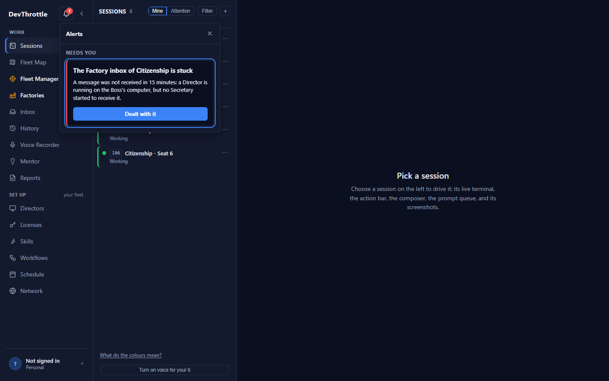
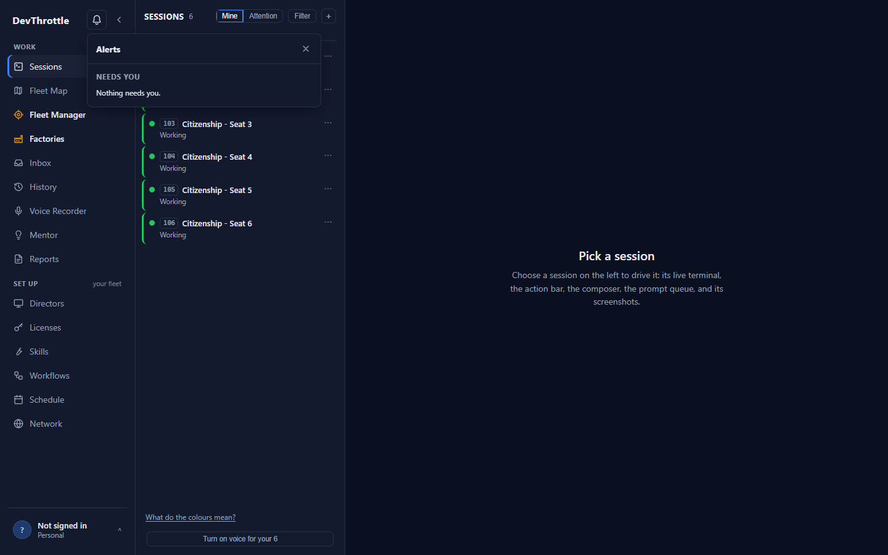
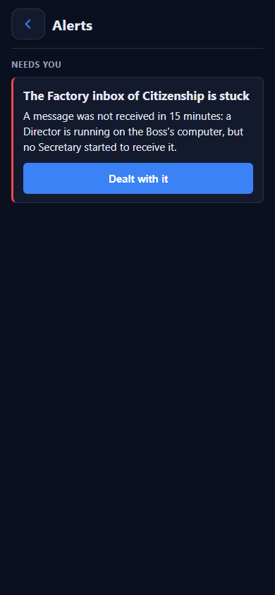

# Issue 4746 - the owner can clear a stuck factory inbox alert

## What was wrong

"The Factory inbox of X is stuck" was computed from the inbox's own messages, and only a Secretary receiving a
message ended it. When no Secretary could start (on 7 November the installed tools lacked `factory inbox`, issue
4744), the alert stood under Needs you for ever: the owner had dealt with the message himself and had no way to say so.

## What changed

- **One owner route on the factory inbox, not on alerts:** `POST /gateway/factory/{factory}/inbox/dealt-with`.
  Only the owner's own phone or Cockpit may call it. A session key is refused (also by the session key guard, which
  never allowed it) and so is the machine token. A badly spelled factory id is refused 400. The factory need NOT still
  be registered: deleting a factory leaves its inbox rows and the alert is raised from those rows, so a deleted
  factory's alert must be clearable too. When nothing is stuck now it is refused 409 in words: "This factory's inbox
  is not stuck now, so nothing was marked. ..."
- **The Gateway decides what is marked** (`FactoryInboxStore.DealtWithByOwner`). It marks exactly what the stuck alert
  counts, using the alert's own three rules, which are now shared expressions in `FactoryInboxStuckAlertSource`:
  a message no Secretary received in 15 minutes; a message held by a Secretary that has ended; and every undecided
  message of a bundle the Boss has not decided in 2 hours, after which those bundles close. Each marked message becomes
  `decided` with no Boss decision and records `OwnerDealtWithAtUtc` and `OwnerDealtWithBy` (the device id). It leaves
  every queue, so a Secretary that starts later does not file it. Each update repeats its own condition, so a message a
  Secretary receives between the read and the write stays with that Secretary. In the other direction, the
  Secretary's receive now refuses to claim a decided message, so a Secretary on a second Gateway process (a deploy
  overlap) cannot take back what the owner dealt with.
- **Nothing else is touched.** A message sent a minute ago, or held by a Secretary that is still running, goes on as
  normal. If it becomes stuck later it raises the alert again - a new stuck condition after the dismissal is a new alert.
- **The thread says who and when.** The message's state label and its last trail step read "Dealt with by the owner"
  with the time; its tone is ok; the factory row no longer counts it as waiting; the summary line says "N dealt with by
  the owner" (counted by when he marked them, as decisions are counted by when they were made) and does not count them
  as waiting.
- **One control, shared by both surfaces.** `FactoryInboxStuckActions` in client-core, rendered by `AlertDetail`, which
  both the Cockpit's alerts tray and the phone's Alerts screen use. It calls `dealtWithFactoryInbox` in the factory inbox
  client; a refusal is shown in the Gateway's own sentence.
- **Real migrations for both databases**, generated with `dotnet ef migrations add AddOwnerDealtWithToFactoryInbox`:
  SQLite (`Data/Migrations/20261107222517_...`) and PostgreSQL (`Migrations.Postgres/Migrations/20261107222606_...`),
  each adding the two nullable columns, with both model snapshots updated. The device column has the same length (200)
  and, on PostgreSQL, the same "C" collation as the row's other device id.

### What the earlier draft did, and why it was replaced

The draft added `POST /gateway/alerts/{id}/owner-dealt-with` and parsed the factory out of the alert id; built a
second `FactoryInboxStore` per request (outside the shared store's lock); marked EVERY undecided message of the factory,
including ones not yet stuck and ones a running Secretary held, while leaving them in the to-file queue so a Secretary
would still file them; hid them from only two of the alert's three reasons, so a stuck bundle could not be cleared;
shipped a hand-written SQLite migration with no snapshot change and no PostgreSQL migration; and its button used class
names that do not exist in the stylesheet. All of that is gone.

## Evidence

### New tests

- `FactoryInboxStuckAlertSourceTests` (store and alert together, seven tests): a message no Secretary received ends the
  alert, records who and when, and no Secretary files it later; a message not yet stuck is left and raises the alert
  again when its time runs out; a message held by an ended Secretary is cleared and its claim released; a running
  Secretary's message is never taken; an undecided bundle is cleared and closed; nothing stuck is refused and changes
  nothing; one account never touches another's.
- `FactoryInboxEndpointTests` (nine cases): phone and Cockpit both mark and the thread, row and stored device id say
  so; two session keys and the machine token are refused 403 and change nothing; nothing stuck is 409 in words; a
  factory with no inbox is 409; a deleted factory's stuck inbox is cleared; a bad factory id is 400.
- `FactoryInboxStuckAlertSourceTests.Summary_CountsTheOwnersMark_ByWhenHeMadeIt_NotWhenTheMessageWasSent`.
- `FactoryInboxSessionKeyGuardTests`: the new route is refused to a session key.
- client-core `actions.test.tsx`: the button posts to the factory's route and tells the list; a refusal shows the
  Gateway's sentence and does not tell the list. `Alerts.test.tsx`: the stuck card offers exactly one button, "Dealt
  with it" (it used to assert none); pressing it posts to the route and the card leaves.

### Red on main, green here

A detached worktree of origin/main 40c1e1257 with only the new test files copied in:

- `FactoryInboxEndpointTests.DealtWith*`: **7 of 7 failed** - every one answered 404 Not Found where the test expected
  200, 403 or 409, because main has no such route. (The two assertions on the new `OwnerDealtWithBy` column were
  removed from that copy only, so it would compile.)
- `Alerts.test.tsx`: **2 failed, 36 passed** - the two stuck-alert tests, because main renders no button.
- The store tests call `DealtWithByOwner`, which does not exist on main, so they cannot compile there; their red is the
  missing method, not a behaviour.

On this branch every one of them passes.

The three tests added for the review findings were shown red the same way, by putting the endpoint, store and fold
files of the previous head (160d4b9ea) back over the new tests: the deleted factory answered 404 where 200 was
expected, the factory with no inbox answered 404 where 409 was expected, and the summary read "Nothing came in and
nothing was decided." where "0 messages came in; 0 decisions made; 1 dealt with by the owner." was expected.

### The gate

Run twice with `.\scripts\test-local.ps1 -Parked`, both **RESULT: GREEN, tree clean**: first at 931f82fd9 (before
the review), then at 6d11fcd73 (after answering it), both on origin/main 40c1e1257. The second run, every suite
outcome=Completed:
Core.UnitTests 3,639; Avalonia.Tests 1,272; Engine.Tests 85; HostedAgent.Tests 85; Launcher.Tests 234;
Terminal.Avalonia.Tests 111; Reclaim.Tests 307; DeliveryQualification.Tests 151; RuleHook.Tests 70;
cc-director-setup.Tests 43; cc-director-setup-engine.Tests 1,023 of 1,029 (6 skipped); cc-director-setup-cli.Tests 78;
Gateway.Tests 426 + 482 + 439 (3 skipped) + 489 in four shards; Core.Tests 4,643 of 4,661 (18 skipped);
Gateway.UnitTests 17,497. Gate record:
`%LOCALAPPDATA%\cc-director\test-gate\gated\6d11fcd737cd3102116bbf95ddffd9cc44f51fb5-20261107T235953Z.json`.

After that run main moved by three commits (v2.38.0 and the session-start change, pull request 4755); none touches a
file this change touches or a migration. The branch was rebased onto 436dc5db0, built, and the 229 factory inbox
tests in Gateway.UnitTests passed there. The full parked gate was NOT re-run on the rebased head.

The C: drive had 4.8 GB free and the parked gate refuses below 15 GB, so the run was made with TEMP and TMP pointed
at a scratch folder on D: (330 GB free); the gate's own temporary-folder handling is unchanged. Nothing on C: was
deleted.

Web tests, after the review fixes: client-core 2,498 passed (193 files); Cockpit 1,504 passed (138 files); mobile 214
passed (41 files).

### Screenshots

Captured from the real Cockpit route table and frame (alerts tray opened by its own `?alert=` deep link, 1440 by 900)
and the real phone Alerts screen (390 by 844). Only the network answers are faked - one stuck alert worded exactly as
the Gateway words it, and the post that removes it. Rebuild with `node scripts/qa/factory-inbox-stuck-alert/build.mjs`.
In both, pressing "Dealt with it" sent `POST /gateway/factory/citizenship/inbox/dealt-with` and the card left.

| | Before | After pressing "Dealt with it" |
|---|---|---|
| Cockpit |  |  |
| Phone |  |  |

## What is NOT proven

- No run against a live Gateway with a real stuck factory: the screenshots use the real screens over a faked network,
  and the Gateway behaviour is proven by the tests over the real store and a throwaway SQLite database.
- The PostgreSQL migration was generated, not applied: no test here runs on PostgreSQL.
- The Secretary's receive guard against a decided message (review finding 2) has no test: the race needs two Gateway
  processes interleaving inside one receive, which a single-process test cannot produce.
- The alert is computed, so after the press the card simply leaves; there is no "Dealt with" line under Earlier, and
  the record of the act is the factory thread.

## Review

A separate review session (Claude Code on Fable; the Codex seat refused the model it was given) read the diff at
160d4b9ea. It confirmed the three shared rules are the one definition, bundle closing, the route's refusals, the
queues that exclude a decided message, and that the client decides nothing. Its findings and the answers:

1. **Medium - a deleted factory's stuck alert could never be cleared** (the route answered 404). Fixed: the route no
   longer requires a registered factory; test `DealtWith_ADeletedFactorysStuckInbox_CanStillBeCleared`, shown red.
2. **Low - across two Gateway processes a Secretary could take back a message the owner dealt with**, because the
   receive update did not repeat the state. Fixed: it now requires the message not be decided. Not test-proven (see
   above).
3. **Low - the summary counted the owner's marks by send time but decisions by decision time.** Fixed: counted by when
   he marked them; test `Summary_CountsTheOwnersMark_ByWhenHeMadeIt_NotWhenTheMessageWasSent`, shown red.
4. **Low - the device column had no length and no collation**, unlike its sibling. Fixed in the model; both
   migrations regenerated.
5. **Low, inherited - the action block's mount flag is cleared for good by a development double mount.** Fixed in the
   new block (set on every mount). The two older action blocks with the same pattern were left as they are: they are
   outside this issue.
