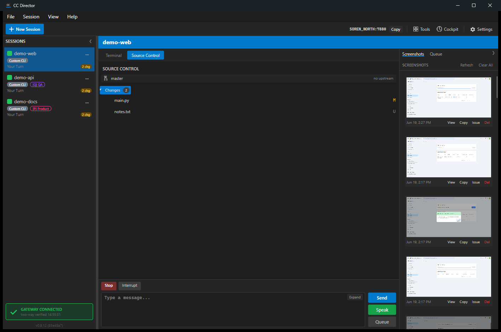

# Source Control and Repositories

DevThrottle keeps git front-and-center so you can see what each session changed
without leaving the app.

## Source control tab

The Source Control tab shows the uncommitted changes for the active session's
repository as a tree of folders and files, each tagged with its git status
(modified, added, deleted, and so on). Right-click a file for View File, Copy
Path, and Add to .gitignore.

## Repository manager

The Repository Manager lists the repositories DevThrottle knows about and lets
you quick-launch a session against any of them.

_Screenshot pending - open from the toolbar / repositories area to capture._

## Connect GitHub

**Settings > GitHub** shows whether git and the GitHub command line (`gh`) are
installed and whether `gh` is signed in. It installs what is missing (Homebrew on a
Mac, winget on Windows) and signs `gh` in, both in a terminal window you can see; the
sign-in also sets up git, so a `git push` from any session uses it. The first-run
wizard has the same step, and the Home screen's **GitHub** row says whether this
machine is signed in, with **Fix** to get there.

To bring a repository onto the machine, clone it yourself (`git clone` or
`gh repo clone`) into one of your root folders; DevThrottle picks it up.
